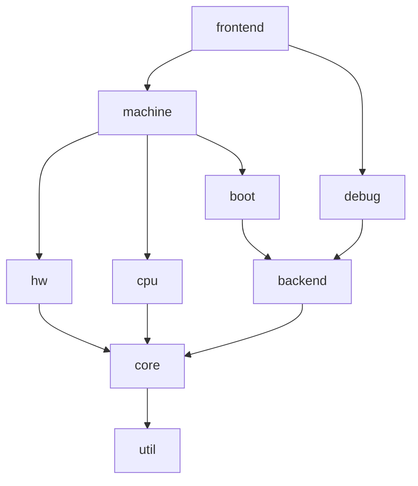

# Architecture

siliconmirror is split into modules, one directory each under `src/`.
Modules form layers: a module may use the modules below it, never the
ones above. This keeps the core independent of any CPU architecture or
board, so new ones can be added without changing it.

## Source tree

The full planned layout is shown below. A directory is created when its
first code lands, so some of them do not exist yet.

```
.github/workflows/    Continuous integration
cmake/                CMake helper files (for example the AArch64
                      toolchain used to build test programs)
docs/                 Design documentation
  architecture.md     This file
  boards/             One page per board: memory map, devices, boot
scripts/              Developer scripts
src/
  util/               Generic helpers: bit operations, byte order,
                      MBR/FAT reading, device tree building
  core/               Board-independent core: memory bus, interrupt
                      lines, virtual time and timed events, the CPU
                      and character stream interfaces, the machine
                      main loop
  cpu/
    arm64/            AArch64 decoder, interpreter, MMU, system registers
  hw/                 Device models, grouped by kind
    char/             UARTs (pl011, bcm2835_aux)
    intc/             Interrupt controllers (bcm2836_local, bcm2835_ic)
    timer/            Timers (bcm2835_systimer)
    sd/               SD host controllers and SD cards
    misc/             Everything else (bcm2835_mbox)
  backend/            Host resources used by devices
    char/             Character streams: stdio, file, socket
    block/            Block storage: raw image files
  boot/               Boot methods: direct kernel load, Raspberry Pi
                      firmware emulation
  machine/            Board definitions (raspi3b): CPUs, memory map,
                      devices, boot method; the list of boards for -M
  debug/              GDB stub, instruction tracing
  frontend/           Command line, machine configuration files, main()
tests/
  unit/               C unit tests for single modules
  cli/                Command-line tests
  baremetal/          AArch64 test programs run inside the emulator
```

## Layers



A module may include headers from every module it can reach by following
the arrows, and from no other module:

| Module     | May include                                         |
|------------|-----------------------------------------------------|
| `util`     | nothing                                             |
| `core`     | `util`                                              |
| `backend`  | `core`, `util`                                      |
| `cpu`      | `core`, `util`                                      |
| `hw`       | `core`, `util`                                      |
| `boot`     | `backend`, `core`, `util`                           |
| `debug`    | `backend`, `core`, `util`                           |
| `machine`  | `backend`, `boot`, `cpu`, `hw`, `core`, `util`      |
| `frontend` | everything                                          |

`make test` enforces this table with
[scripts/check-layering.sh](../scripts/check-layering.sh). When you add a
module, add it to both the script and this table.

Two consequences are worth stating plainly:

- `core` knows nothing about ARM or the Raspberry Pi. It talks to CPUs and
  devices only through small interfaces (function pointer tables) that
  they implement.
- `hw` and `cpu` do not know about each other. A device raises an
  interrupt line; the machine connects that line to an interrupt
  controller, and the controller to a CPU.

## Devices and back ends

`hw/` holds what the guest sees: a PL011 UART with its registers. `backend/`
holds what the host provides: your terminal, a log file, a socket. The
machine connects the two, so the same PL011 model can print to a terminal
or write to a file without any change to its code.

Since `hw` may not depend on `backend`, the two meet through an interface
defined in `core`: a UART writes to a `CharStream` (`core/char_stream.h`),
and each back end in `backend/char/` implements one.

Devices are grouped by kind, not by board. A PL011 exists on many ARM
boards, so a future board can reuse it directly.

## Machines and boot methods

A machine (`machine/raspi3b.c`) only assembles parts: it creates the CPUs
and RAM, maps each device at its address, wires interrupt lines and picks
a boot method. The boot method decides how software gets into memory:

- `boot/direct`: load a file given with `-kernel` and jump to it. Used for
  development and tests.
- `boot/raspi_fw`: do what the Raspberry Pi firmware does: read
  `config.txt`, the kernel and the device tree from the SD card image.

## Virtual time

Virtual time counts nanoseconds and only moves while the machine runs.
Each instruction takes 1 ns, as on a nominal 1 GHz CPU. Time therefore
depends on the number of instructions run, not on the speed of the host,
and running the same guest twice gives exactly the same result.

The main loop, `machine_run()` in `core/machine.c`, works in turns:

1. A turn covers 1 µs of virtual time, or less when an event is due
   sooner.
2. Each running CPU executes the instructions that fit in the turn, one
   CPU after the other.
3. Virtual time moves to the end of the turn and the events that are due
   fire, for example a timer that raises an interrupt and wakes a CPU.

When every CPU is waiting (WFI, WFE), time jumps straight to the next
event. When no event is pending either, nothing can ever happen again, so
the machine stops with `MACHINE_STOP_IDLE`.

Known limits, to be handled when the devices that need it arrive:

- While a CPU runs, devices see the time at the start of the turn, so
  they observe time in steps of up to 1 µs.
- Input from the host, such as a terminal connected to a UART, can wake
  a waiting machine, so such a machine must wait for input instead of
  stopping as idle.

## Headers and naming

- Each header sits next to its source file and is included by its path
  from `src/`, for example `#include "core/bus.h"`.
- Functions and types that a module exports start with the module or
  device name, for example `bus_read()` or `pl011_create()`.
- Everything else in a source file is `static`.

## Tests

- `tests/unit/`: one test program per module, linked against that module
  only, without the rest of the emulator.
- `tests/cli/`: run `smirror` with options and check its output and exit
  status.
- `tests/baremetal/`: small AArch64 programs, built with the cross
  toolchain, that run inside the emulator and print their result on the
  UART.
